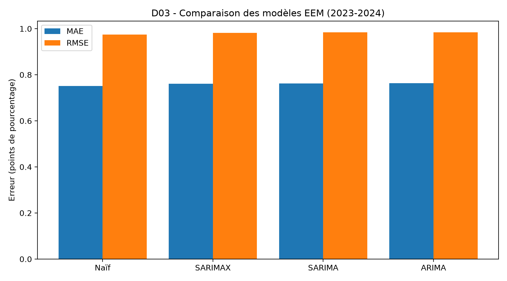
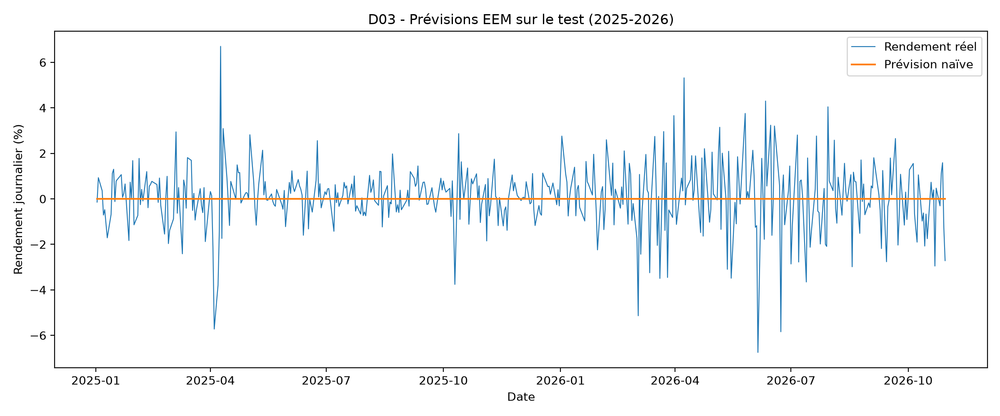

# Projet B08 — EEM QuantLab
## Livrable D03 : Économétrie de la moyenne

### 1. Introduction

Ce livrable porte sur la modélisation économétrique des rendements journaliers de l'ETF iShares MSCI Emerging Markets (EEM), avec l'ETF SPDR S&P 500 (SPY) comme variable explicative potentielle.

L'objectif est d'étudier la prévisibilité de la moyenne conditionnelle des rendements, de comparer plusieurs modèles économétriques et d'évaluer leurs performances prédictives hors échantillon.

Quatre approches sont étudiées : un modèle naïf fondé sur la moyenne historique, ARIMA, SARIMA et SARIMAX.

### 2. Présentation et préparation des données

Les données financières couvrent la période du 2 janvier 2018 au 30 octobre 2026.

Les séries EEM et SPY comportent chacune 2 220 observations de prix ajustés.

Les rendements logarithmiques journaliers sont calculés selon :

r_t = 100 × ln(P_t / P_{t-1})

où P_t représente le prix ajusté à la date t.

Après calcul des rendements, chaque série comporte 2 219 observations.

### 3. Découpage chronologique

Afin d'éviter toute fuite d'information, les observations sont réparties chronologiquement :

| Échantillon | Période | Observations |
|---|---|---:|
| Entraînement | 2018–2022 | 1 258 |
| Validation | 2023–2024 | 502 |
| Test | 2025–2026 | 459 |

L'entraînement sert à estimer les modèles, la validation à les comparer et le test à évaluer définitivement le modèle sélectionné.

### 4. Méthodologie économétrique

#### 4.1 Modèle naïf

Le modèle naïf prévoit un rendement constant égal à la moyenne historique estimée sur l'échantillon d'entraînement.

Il constitue une référence permettant de déterminer si les modèles économétriques apportent une amélioration prédictive.

#### 4.2 Modèle ARIMA

Les modèles ARIMA(p,d,q) combinent une composante autorégressive, une différenciation éventuelle et une composante moyenne mobile.

Plusieurs spécifications sont estimées et comparées à partir du critère AIC, des diagnostics des résidus et des erreurs de prévision.

#### 4.3 Modèle SARIMA

Le modèle SARIMA étend ARIMA en introduisant une composante saisonnière.

Une périodicité de cinq séances boursières est étudiée afin d'examiner l'existence d'une structure hebdomadaire.

#### 4.4 Modèle SARIMAX

Le modèle SARIMAX introduit une variable explicative externe : le rendement de SPY retardé d'une séance.

Ce décalage permet de n'utiliser, pour chaque prévision, qu'une information disponible antérieurement à la date prédite.

### 5. Critères d'évaluation

Les performances prédictives sont mesurées par :

- MAE : erreur absolue moyenne.
- RMSE : racine de l'erreur quadratique moyenne.

Les modèles sont comparés sur la validation selon un protocole commun de prévision à un pas.

Les modèles économétriques sont actualisés avec les observations successivement disponibles, sans réestimation de leurs paramètres à chaque séance.

Le modèle naïf conserve la moyenne estimée sur l'entraînement.

### 6. Résultats des modèles économétriques

#### 6.1 Comparaison des modèles ARIMA

Sept spécifications ARIMA ont été estimées.

Le modèle ARIMA(2,0,2) présente le plus faible AIC parmi les modèles étudiés, avec une valeur de 4485,98.

Le modèle ARIMA(3,0,1) obtient le meilleur RMSE lors de la comparaison initiale à horizon multiple : 0,9723.

Ces résultats montrent que le modèle présentant le plus faible AIC n'est pas nécessairement celui qui produit les meilleures prévisions.

#### 6.2 Diagnostics des résidus

Les diagnostics du modèle ARIMA(1,0,1) donnent les résultats suivants :

| Test | Résultat |
|---|---:|
| Ljung-Box retard 5 | p = 0,566488 |
| Ljung-Box retard 10 | p = 0,000207 |
| Ljung-Box retard 20 | p = 0,001109 |
| ARCH-LM | Statistique = 389,2944 |

Les tests de Ljung-Box révèlent une autocorrélation résiduelle significative aux retards 10 et 20.

Le test ARCH-LM est également significatif, ce qui suggère la présence d'hétéroscédasticité conditionnelle.

Ces résultats motivent l'étude de la volatilité dans le livrable D04.
### 7. Comparaison des performances sur validation

Les quatre modèles sont évalués sur 502 observations de validation couvrant la période 2023–2024.

La comparaison repose sur un protocole de prévision à un pas, avec actualisation des observations disponibles pour les modèles économétriques.

| Modèle | MAE | RMSE |
|---|---:|---:|
| Naïf | 0,7519 | 0,9740 |
| SARIMAX(3,0,1) + SPY retardé | 0,7609 | 0,9821 |
| SARIMA(3,0,1) × (1,0,0,5) | 0,7623 | 0,9840 |
| ARIMA(3,0,1) | 0,7630 | 0,9843 |

Le modèle naïf présente les plus faibles erreurs MAE et RMSE sur la période de validation.

Le modèle SARIMAX obtient les meilleures performances parmi les trois modèles économétriques complexes, mais ne surpasse pas le modèle naïf.

Par conséquent, le modèle naïf est retenu pour l'évaluation finale hors échantillon.

### 8. Évaluation finale hors échantillon (2025–2026)

#### 8.1 Protocole d’évaluation

Après comparaison des quatre modèles sur la période de validation, le modèle naïf a été retenu en raison de ses meilleures performances prédictives.

La moyenne historique a ensuite été réestimée sur les données d'entraînement et de validation, couvrant la période 2018–2024.

Les observations de test n'ont pas été utilisées pour estimer le modèle ou sélectionner sa spécification, afin d'éviter toute fuite d'information.

#### 8.2 Résultats du test final

L'évaluation finale porte sur 459 observations journalières de l'ETF EEM, du 2 janvier 2025 au 30 octobre 2026.

La moyenne historique estimée est de 0,001197 % par séance.

| Indicateur | Résultat |
|---|---:|
| Nombre d'observations | 459 |
| Moyenne prédite | 0,001197 % |
| MAE | 1,0075 |
| RMSE | 1,4311 |

#### 8.3 Interprétation des résultats

Le modèle naïf obtient un RMSE de 1,4311 sur le test, contre 0,9740 sur la validation.

Cette augmentation indique une dégradation de la précision prédictive sur la période finale.

Elle peut notamment refléter une évolution de la dispersion des rendements financiers. Toutefois, une analyse complémentaire de la volatilité serait nécessaire pour confirmer cette hypothèse.

Ces résultats soulignent les difficultés de prévision de la moyenne des rendements journaliers des actifs financiers.

### 9. Discussion des résultats et limites

Les résultats obtenus montrent que les modèles économétriques complexes ne garantissent pas une amélioration des prévisions des rendements financiers.

Sur la période de validation 2023-2024, le modèle naïf présente les meilleures performances parmi les quatre approches étudiées.

Le modèle SARIMAX, intégrant le rendement retardé de SPY, obtient les meilleures performances parmi les modèles économétriques complexes, mais reste moins performant que le modèle naïf.

Plusieurs limites doivent être soulignées :

- Les résultats dépendent des périodes étudiées.
- La périodicité saisonnière de cinq séances reste une hypothèse de modélisation.
- La variable SPY retardée ne permet pas d'améliorer les performances dans cette expérience.
- Les performances de validation ne garantissent pas les mêmes performances sur d'autres périodes.
- La comparaison des erreurs ne suffit pas à expliquer les changements de volatilité.

### 10. Conclusion générale et transition vers D04

Ce livrable D03 a permis de développer et d'évaluer plusieurs modèles de prévision de la moyenne conditionnelle des rendements journaliers de l'ETF EEM.

Les modèles naïf, ARIMA, SARIMA et SARIMAX ont été comparés sur une période de validation commune.

Le modèle naïf a obtenu les meilleurs résultats avec un MAE de 0,7519 et un RMSE de 0,9740.

Après réestimation sur les données d'entraînement et de validation, son évaluation finale sur 459 observations de test a produit un MAE de 1,0075 et un RMSE de 1,4311.

Les diagnostics ARCH-LM réalisés sur ARIMA(1,0,1) suggèrent la présence d'hétéroscédasticité conditionnelle.

Ces résultats motivent le passage au livrable D04, consacré à la modélisation de la volatilité conditionnelle à travers les modèles ARCH/GARCH et à l'évaluation du risque financier par les mesures Value at Risk (VaR) et Expected Shortfall (ES).
